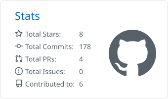
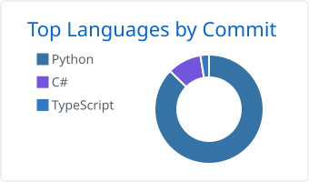

**🌐 English | [한국어](README.ko.md)**

# Hi, I'm Sungyup Kim 👋

**MLOps · LLM Platform Developer** — Seoul, South Korea 🇰🇷

## 🔭 What I do

- Build and operate LLM agent platforms and MLOps infrastructure
- Experiment with tool integrations based on MCP (Model Context Protocol)
- Build API authorization (ABAC) on Spring Cloud Gateway + Keycloak, along with an admin console for managing policies visually
- Lately I'm absorbed in a reinforcement-learning side project using MuJoCo + PPO that teaches a 2D ragdoll
  to get up from a fallen pose and stand on its own (walking and fighting are on hold until standing is stable).
  Having been burned several times by the fact that "training-log numbers lie", I'm especially interested in
  methodology: re-measuring every result with fixed seeds and deterministic evaluation, and documenting
  failed attempts too

## 📌 Projects

| Project | Description | Stack |
|---|---|---|
| [standai](https://github.com/SungyupKim/standai) | A 2D ragdoll that gets up from fallen poses (lying on back/front) — 2 floor policies + a standing policy + a rule-based controller, fixed-seed evaluation (~24% end to end; bottleneck analysis and failure logs published) | Python, PPO, MuJoCo |
| [fightai](https://github.com/SungyupKim/fightai) | 2D ragdoll self-play fighting league — the original starting point of standai | Python |
| [keycloak-gateway-policy-console](https://github.com/SungyupKim/keycloak-gateway-policy-console) | Admin console that maps APIs behind Spring Cloud Gateway to Keycloak resources, permissions and ABAC policies with a Flow editor, and simulates authorization evaluation (OAuth2 login, policy CRUD, KO/EN UI) | Java, Spring Cloud Gateway, Keycloak, React, TypeScript |

## 📊 GitHub Stats

## 📫 Contact

- GitHub: [@SungyupKim](https://github.com/SungyupKim)
